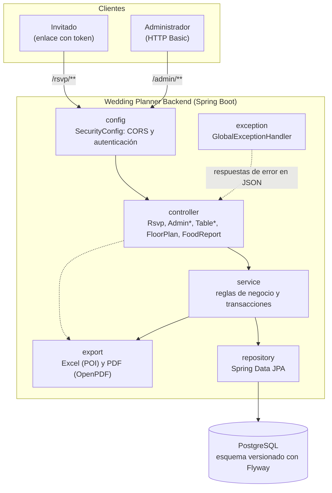
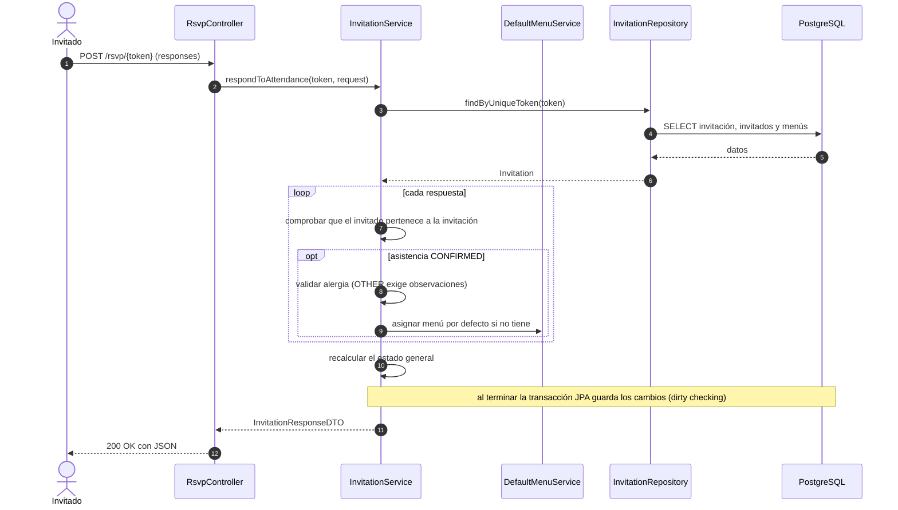
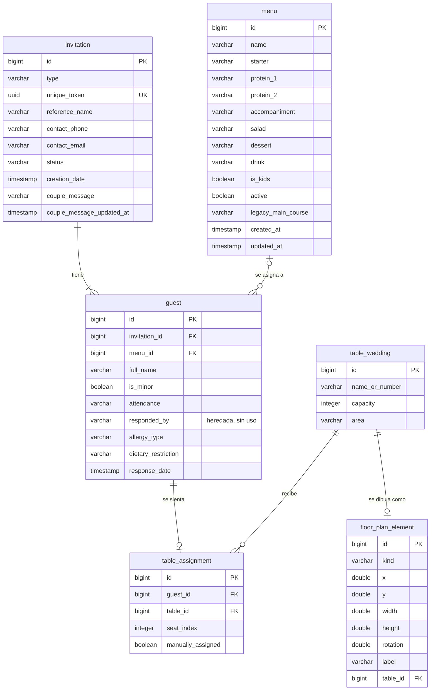

# Wedding Planner Backend

API REST para organizar una boda: invitaciones con enlace privado, confirmación de asistencia (RSVP), menús, alergias alimentarias, mesas, plano del salón y reportes para el catering.

> **Alcance de este documento.** Se redactó a partir del análisis del código fuente del repositorio (versión `1.0-SNAPSHOT`). Todo lo descrito corresponde a lo que el código implementa. **La compilación y las pruebas automatizadas no se ejecutaron al redactarlo**, por lo que no se afirma que pasen. Lo que no pudo comprobarse está marcado como **Pendiente de verificación** y reunido en la sección [13](#13-observaciones-pendientes-y-limitaciones).

## Tabla de contenido

- [Inicio rápido](#inicio-rápido)
- [1. Resumen del proyecto](#1-resumen-del-proyecto)
- [2. Funcionalidades](#2-funcionalidades)
- [3. Tecnologías y arquitectura](#3-tecnologías-y-arquitectura)
- [4. Requisitos previos](#4-requisitos-previos)
- [5. Instalación y primera ejecución](#5-instalación-y-primera-ejecución)
  - [5.1 Obtener el proyecto y abrir la carpeta correcta](#51-obtener-el-proyecto-y-abrir-la-carpeta-correcta)
  - [5.2 Verificar Java](#52-verificar-java)
  - [5.3 Instalar PostgreSQL](#53-instalar-postgresql)
  - [5.4 Crear la base de datos y un usuario dedicado](#54-crear-la-base-de-datos-y-un-usuario-dedicado)
  - [5.5 Configurar las variables de entorno](#55-configurar-las-variables-de-entorno)
  - [5.6 Descargar dependencias y compilar](#56-descargar-dependencias-y-compilar)
  - [5.7 Iniciar la aplicación](#57-iniciar-la-aplicación)
  - [5.8 Comprobar que inició correctamente](#58-comprobar-que-inició-correctamente)
  - [5.9 Crear los menús por defecto (obligatorio en un entorno nuevo)](#59-crear-los-menús-por-defecto-obligatorio-en-un-entorno-nuevo)
  - [5.10 Detener la aplicación](#510-detener-la-aplicación)
  - [5.11 Flujo de trabajo típico](#511-flujo-de-trabajo-típico)
- [6. Configuración y variables de entorno](#6-configuración-y-variables-de-entorno)
- [7. Uso de la API](#7-uso-de-la-api)
  - [7.1 Convenciones generales](#71-convenciones-generales)
  - [7.2 Autenticación, errores y códigos HTTP](#72-autenticación-errores-y-códigos-http)
  - [7.3 RSVP público (`/rsvp`)](#73-rsvp-público-rsvp)
  - [7.4 Invitaciones (`/admin/invitations`)](#74-invitaciones-admininvitations)
  - [7.5 Menús](#75-menús)
  - [7.6 Mesas y asignaciones](#76-mesas-y-asignaciones)
  - [7.7 Plano del salón](#77-plano-del-salón)
  - [7.8 Reporte de alimentación](#78-reporte-de-alimentación)
  - [7.9 Mensajes de los invitados (administración)](#79-mensajes-de-los-invitados-administración)
  - [7.10 Probar con Postman](#710-probar-con-postman)
- [8. Base de datos y modelo de información](#8-base-de-datos-y-modelo-de-información)
- [9. Estructura del proyecto](#9-estructura-del-proyecto)
- [10. Pruebas, compilación y calidad](#10-pruebas-compilación-y-calidad)
- [11. Solución de problemas](#11-solución-de-problemas)
- [12. Seguridad y buenas prácticas](#12-seguridad-y-buenas-prácticas)
- [13. Observaciones pendientes y limitaciones](#13-observaciones-pendientes-y-limitaciones)
- [14. Contribución y mantenimiento](#14-contribución-y-mantenimiento)
- [15. Licencia, autoría y contacto](#15-licencia-autoría-y-contacto)

## Inicio rápido

Para quien ya tiene JDK 17+ y PostgreSQL. Cada paso se explica en detalle en la sección [5](#5-instalación-y-primera-ejecución).

```bash
# 1. Crear la base de datos vacía (ver sección 5.4) y definir las variables de entorno
export DB_URL="jdbc:postgresql://localhost:5432/wedding_planner"
export DB_USERNAME="wedding_user"
export DB_PASSWORD="<tu-contraseña>"
export ADMIN_USERNAME="<usuario-admin>"
export ADMIN_PASSWORD="<contraseña-admin>"
export APP_CORS_ALLOWED_ORIGINS="http://localhost:4200"

# 2. Iniciar (desde la raíz del proyecto; Flyway crea las tablas al arrancar)
./gradlew bootRun
```

> **Importante en el primer uso:** la aplicación no crea los menús por defecto. Antes de registrar invitados hay que crear un menú de adultos llamado `Menú 1` y uno infantil llamado `Menú Infantil 1` (ver [5.9](#59-crear-los-menús-por-defecto-obligatorio-en-un-entorno-nuevo)).

---

## 1. Resumen del proyecto

### 1.1 Nombre y propósito

El nombre del sistema es **Wedding Planner Backend** (así figura en `settings.gradle.kts` como `rootProject.name` y en `spring.application.name`). Es la parte del servidor (*backend*) de una aplicación de planificación de bodas. El repositorio **no contiene pantallas**: expone una API REST en JSON que consume un frontend independiente (el código lo menciona como una aplicación Angular; ese repositorio no forma parte de este proyecto).

**Problema que resuelve.** Organizar una boda implica saber quién asistirá, qué comerá cada persona, quién tiene alergias, en qué mesa se sentará cada invitado y entregar esa información al catering. Hacerlo con hojas de cálculo y mensajes sueltos es lento y propenso a errores. Este sistema centraliza esos datos y permite que cada invitado responda por sí mismo desde un enlace privado.

### 1.2 Explicación para personas no técnicas

Imagina que una pareja organiza su boda. Este sistema es el "cerebro" que guarda y ordena la información. Funciona así:

1. **La pareja registra las invitaciones.** Cada invitación es para una persona o para una familia, y recibe un **enlace privado único**.
2. **Cada invitado abre su enlace** (no necesita crear cuenta ni contraseña), indica quién asistirá, si alguien tiene alergias y, si quiere, deja un mensaje para los novios.
3. **La pareja revisa las respuestas**, arma las mesas (de forma automática o a mano), dibuja el plano del salón y descarga reportes en Excel o PDF para entregar al catering.

El sistema asigna a cada invitado un menú por defecto (uno para adultos y otro para niños), de modo que el invitado **no elige menú**: solo confirma asistencia y declara alergias.

### 1.3 Explicación técnica

Aplicación **Spring Boot 4.1.1** escrita en **Java**, construida con **Gradle (Kotlin DSL)**. Expone una API REST JSON sin estado sobre HTTP, organizada en capas `controller → service → repository`, con persistencia en **PostgreSQL** mediante Spring Data JPA (Hibernate). El esquema se versiona con **Flyway** (7 migraciones) y Hibernate solo lo **valida** (`ddl-auto: validate`). La seguridad usa **Spring Security**: `/rsvp/**` es público (el token UUID de la URL actúa como credencial) y `/admin/**` exige **HTTP Basic** con el rol `ADMIN`. Los reportes se generan con **Apache POI** (Excel) y **OpenPDF** (PDF).

### 1.4 Objetivos

**Objetivo general:** permitir a una pareja gestionar la lista de invitados de su boda y la logística asociada (comida y ubicación en el salón) con la información que los propios invitados proporcionan.

**Objetivos específicos** (inferidos del código):

- Registrar invitaciones individuales o familiares y generar un enlace privado por invitación.
- Recoger la confirmación de asistencia por invitado, con alergias alimentarias y observaciones.
- Asignar automáticamente un menú por defecto según la categoría del invitado (adulto o menor).
- Administrar un catálogo de menús (entrada, plato fuerte, postre, bebida).
- Recibir mensajes opcionales de los invitados para los novios y consultarlos.
- Administrar mesas y asignar invitados a mesas y sillas, de forma automática o manual.
- Diseñar el plano del salón y exportarlo a PDF junto con la lista de quién se sienta en cada mesa.
- Generar reportes de alimentación para el catering (JSON, Excel y PDF).

### 1.5 Usuarios a los que está dirigido

| Usuario | Cómo interactúa | Evidencia en el código |
| --- | --- | --- |
| **Administrador** (la pareja u organizadores) | Llama a `/admin/**` con usuario y contraseña (HTTP Basic). | `SecurityConfig`, controladores `Admin*`, textos como "Mensajes de los invitados" y "para los novios". |
| **Invitado** | Usa su enlace privado (`/rsvp/{token}`), sin autenticación. | `RsvpController`, `Invitation.uniqueToken`. |
| **Catering / equipo del salón** | No usa la API directamente: recibe los PDF y Excel que genera el administrador. | Comentario en `FoodPdfExporter`: "PDF pensado para entregar al catering". |

### 1.5.1 Información que el sistema maneja

| Qué | Detalle |
| --- | --- |
| **Recibe** | Invitaciones y sus invitados; respuestas de asistencia; alergias y observaciones; mensajes para los novios; menús; mesas; piezas del plano; imagen PNG del plano (base64). |
| **Procesa** | Estado general de cada invitación; asignación de menús por defecto; asignación automática de mesas; resúmenes de alimentación. |
| **Almacena** | En PostgreSQL: invitaciones, invitados, menús, mesas, asignaciones y piezas del plano (ver [sección 8](#8-base-de-datos-y-modelo-de-información)). |
| **Devuelve** | JSON (consultas y errores), archivos `.xlsx` y `.pdf` (reportes y plano). |

### 1.6 Alcance actual y limitaciones

**Alcance actual:** todo lo listado en la [sección 2](#2-funcionalidades) está implementado en el código.

**Limitaciones identificables** (el código no las implementa):

- **No hay envío de correos, SMS ni WhatsApp.** `contactEmail` y `contactPhone` solo se almacenan; no existe ninguna dependencia ni clase de mensajería.
- **No se pueden editar ni eliminar invitaciones ni invitados** mediante la API (solo crear, consultar y agregar invitados a una invitación existente).
- **Un único usuario administrador**, definido en memoria por variables de entorno. No hay registro de usuarios, roles adicionales, JWT ni gestión de sesiones.
- **No hay documentación OpenAPI/Swagger** generada.
- **No hay limitación de peticiones** (*rate limiting*) en los endpoints públicos.
- La respuesta de un invitado **puede modificarse las veces que se quiera** mientras tenga el enlace: el código no bloquea reenvíos.
- Las **pruebas automatizadas cubren solo parte de la lógica** (ver [sección 10](#10-pruebas-compilación-y-calidad)).

---

## 2. Funcionalidades

El estado se asigna así: **Completa** = el flujo está implementado de extremo a extremo en el código; **Parcial** = falta una parte evidente del ciclo de vida; **Obsoleta** = existe pero el propio código la marca para eliminar.

| # | Funcionalidad | Estado |
| --- | --- | --- |
| F1 | Gestión de invitaciones y enlace privado | Parcial (crear, consultar y ampliar; sin editar ni borrar) |
| F2 | Respuesta de asistencia (RSVP) | Completa |
| F3 | Mensaje para los novios y su consulta administrativa | Completa |
| F4 | Catálogo de menús y menú por defecto | Completa |
| F5 | Gestión de mesas | Completa |
| F6 | Asignación de invitados a mesas y sillas | Completa |
| F7 | Plano del salón y PDF del plano | Completa |
| F8 | Reporte de alimentación (JSON, Excel, PDF) | Completa |
| F9 | Autenticación y CORS | Básica (un solo usuario en memoria) |
| F10 | Listado de menús activos para el RSVP (`GET /rsvp/menu-options`) | Obsoleta |

### F1. Gestión de invitaciones y enlace privado

- **Qué permite:** crear invitaciones `INDIVIDUAL` (una persona) o `FAMILY` (varias personas), listarlas, consultarlas por id y agregar invitados a una existente.
- **Necesidad que resuelve:** tener una lista de invitados organizada y un enlace único por invitación para enviarlo.
- **Cómo se usa:** `POST /admin/invitations`, `GET /admin/invitations`, `GET /admin/invitations/{id}`, `POST /admin/invitations/{id}/guests`. La respuesta incluye `uniqueToken`; con él el frontend construye el enlace que se envía al invitado.
- **Datos que necesita:** tipo, nombre de referencia, teléfono y correo (opcionales) y al menos un invitado (`fullName`, `isMinor`).
- **Resultado:** la invitación con su estado `PENDING`, cada invitado con asistencia `NO_RESPONSE` y su menú por defecto.
- **Validaciones:** `type` obligatorio; `referenceName` no vacío; `contactEmail` con formato de correo; `guests` no vacío; una invitación `INDIVIDUAL` no admite más de un invitado; longitudes máximas iguales a las de las columnas (`referenceName` 150, `contactPhone` 30, `contactEmail` 150, `fullName` 150).
- **Errores posibles:** `400` por datos inválidos o regla de negocio; `409` si el menú por defecto no existe o está inactivo (ver F4).
- **Clases:** `AdminInvitationController`, `AdminInvitationService`, `DefaultMenuService`, `Invitation`, `Guest`.

### F2. Respuesta de asistencia (RSVP)

- **Qué permite:** que el invitado vea su invitación y responda por cada persona: `CONFIRMED` o `NOT_ATTENDING`, con tipo de alergia y observaciones.
- **Necesidad que resuelve:** conocer quién asistirá y qué restricciones alimentarias hay, sin que la pareja capture los datos a mano.
- **Cómo se usa:** `GET /rsvp/{token}` para ver la invitación y `POST /rsvp/{token}` para responder. Sin autenticación: el token es la credencial.
- **Datos que necesita:** una lista de respuestas (no se pide quién responde) con `guestId`, `attendance`, `allergyType` (opcional) y `dietaryRestriction` (opcional, máx. 200 caracteres).
- **Resultado:** la invitación actualizada. El estado general pasa a `PENDING` (nadie respondió), `PARTIALLY_RESPONDED` (algunos respondieron) o `FULLY_RESPONDED` (todos respondieron).
- **Validaciones:** `responses` no vacío; cada `guestId` debe pertenecer a la invitación; si el invitado confirma con alergia `OTHER`, las observaciones son obligatorias.
- **Errores posibles:** `404` si el token no existe; `400` por validación; `409` si, al confirmar, un invitado sin menú no puede recibir el menú por defecto (en ese caso no se guarda ninguna respuesta de la solicitud).
- **Clases:** `RsvpController`, `InvitationService`, `DefaultMenuService`.

### F3. Mensaje para los novios y su consulta administrativa

- **Qué permite:** que cada invitación deje **un** mensaje de texto plano (máx. 1000 caracteres) y que el administrador los consulte con paginación, búsqueda y filtros.
- **Cómo se usa:** `PUT /rsvp/{token}/message` (invitado) y `GET /admin/guest-messages` (administrador).
- **Datos que necesita:** `message` (texto; vacío o `null` borra el mensaje). El listado admite `page`, `size` (máx. 50), `search`, `type` y `filter` (`WITH_MESSAGE` por defecto o `WITHOUT_MESSAGE`).
- **Resultado:** el mensaje normalizado con su fecha de actualización; en el listado, una página de resultados con contadores generales.
- **Validaciones:** longitud máxima 1000. El texto se normaliza (se eliminan caracteres de control, se unifican saltos de línea) y **se guarda como texto plano**: no se sanea HTML, así que quien lo muestre debe escaparlo.
- **Comportamiento:** guardar de nuevo el mismo texto no cambia la fecha de actualización (idempotente).
- **Errores posibles:** `404` token inexistente; `400` si supera la longitud.
- **Clases:** `RsvpController`, `InvitationService`, `MessageText`, `AdminGuestMessageController`, `GuestMessageService`.

### F4. Catálogo de menús y menú por defecto

- **Qué permite:** crear, editar, activar/desactivar, listar y eliminar menús. Cada menú tiene entrada, plato fuerte (proteína 1, proteína 2, acompañamiento, ensalada), postre y bebida, y es de adultos o infantil.
- **Cómo se usa:** `/admin/menus` (ver [7.5](#75-menús)).
- **Regla del menú por defecto:** al crear un invitado, el sistema le asigna el menú llamado `Menú 1` (adultos) o `Menú Infantil 1` (menores). Los nombres se configuran con `app.menus.default-adult-name` y `app.menus.default-kids-name`. Si el menú no existe o está inactivo, la operación falla con `409` y no se guarda nada. Nunca se elige "otro" menú.
- **Validaciones:** nombre único sin distinguir mayúsculas; en un menú de adultos son obligatorios los cuatro componentes del plato fuerte; en uno infantil solo la proteína 1; no se puede cambiar un menú entre adulto e infantil si ya tiene invitados.
- **Errores posibles:** `400` por datos o reglas; `409` al eliminar un menú que ya tiene invitados (se recomienda desactivarlo).
- **Clases:** `AdminMenuController`, `MenuService`, `DefaultMenuService`, `Menu`, `MainCourse`.

### F5. Gestión de mesas

- **Qué permite:** crear, renombrar, cambiar la capacidad, listar y eliminar mesas. El listado indica cuántos lugares están ocupados.
- **Cómo se usa:** `/admin/tables` (ver [7.6](#76-mesas-y-asignaciones)).
- **Validaciones:** `nameOrNumber` no vacío; `capacity` mínima 1; no se puede reducir la capacidad por debajo de los invitados sentados ni dejar invitados en sillas que desaparecerían.
- **Errores posibles:** `400` por validación; `409` al eliminar una mesa con invitados asignados.
- **Clases:** `TableController`, `TableService`, `TableWedding`.

### F6. Asignación de invitados a mesas y sillas

- **Qué permite:** asignar automáticamente a los invitados **confirmados** sin mesa, asignar o mover manualmente a un invitado (con silla opcional), quitar una asignación y consultar la distribución.
- **Algoritmo automático:** agrupa por invitación y procesa primero los grupos más grandes. Cada grupo se coloca completo en la mesa que, entre las que le caben, tenga **menos espacio libre**; si no cabe en ninguna, reparte a sus miembros uno por uno en los lugares libres. Quien no encuentra lugar queda en la lista `unassignedGuests`. No reasigna a quien ya tiene mesa. Las asignaciones automáticas no fijan silla (`seatIndex` nulo).
- **Validaciones (manual):** el invitado y la mesa deben existir; la mesa no puede estar llena (salvo que el invitado ya esté en ella); la silla debe existir en la mesa y no estar ocupada por otro invitado.
- **Observación:** la asignación manual **no exige** que el invitado esté confirmado.
- **Clases:** `TableAssignmentController`, `TableAssignmentService`, `TableAssignment`.

### F7. Plano del salón y PDF del plano

- **Qué permite:** guardar y recuperar el plano como una lista de piezas (mesas redondas o rectangulares, arco, pasillo, pista de baile, escenario, baños, árbol, piano, mesa de regalos, mesa del pastel y texto) con posición, tamaño, rotación y etiqueta. Además genera un PDF con el dibujo del plano y quién se sienta en cada mesa.
- **Cómo se usa:** `GET /admin/floor-plan`, `PUT /admin/floor-plan` (reemplaza el plano completo) y `POST /admin/floor-plan/pdf`.
- **Detalles:** `(x, y)` es el **centro** de la pieza y la rotación va en grados. Las piezas de tipo mesa deben enlazarse a una mesa existente y una mesa aparece una sola vez. El dibujo del plano **lo genera el navegador** (imagen PNG en base64) y el servidor solo lo inserta en el PDF.
- **Validaciones:** `x` e `y` entre -5000 y 5000; `width` y `height` entre 10 y 3000; `rotation` entre -3600 y 3600; `label` máx. 100 caracteres; la imagen del PDF debe ser un PNG de menos de 10 MB.
- **Clases:** `FloorPlanController`, `FloorPlanService`, `FloorPlanPdfService`, `FloorPlanPdfExporter`, `FloorPlanElement`.

### F8. Reporte de alimentación

- **Qué permite:** obtener, por invitado, su menú, alergia y observaciones, y descargar el reporte en Excel o PDF.
- **Cómo se usa:** `GET /admin/food-report` (JSON con **todos** los invitados), `/excel` y `/pdf`.
- **Contenido:** el Excel tiene la hoja `Invitados` (todos los invitados, con las alergias resaltadas) y la hoja `Resumen` (totales sobre confirmados). El PDF incluye resumen, alergias y detalle **solo de confirmados**.
- **Clases:** `FoodReportController`, `FoodReportService`, `FoodExcelExporter`, `FoodPdfExporter`, `ReportLabels`.

### F9. Autenticación y CORS

- **Qué hace:** `/rsvp/**` es público; `/admin/**` exige HTTP Basic con rol `ADMIN`; cualquier otra ruta exige autenticación. CSRF deshabilitado (API sin estado). CORS permite los orígenes configurados.
- **Clases:** `SecurityConfig`.

---

## 3. Tecnologías y arquitectura

### 3.1 Tecnologías

| Tecnología | Versión | Para qué se usa | Dónde se declara |
| --- | --- | --- | --- |
| **Java** (JDK) | Mínimo **17** (requisito de Spring Boot 4.1.x, compatible hasta 26). Entorno de desarrollo del autor: **Temurin 25.0.4.1 (LTS)** | Lenguaje del proyecto | No hay `toolchain` en `build.gradle.kts`; la versión de desarrollo la indica el autor |
| **Spring Boot** | 4.1.1 | Framework base y arranque (`ma.femme.Main`) | `build.gradle.kts` |
| **Gradle (Wrapper)** | 9.3.0 | Compilación y gestión de dependencias | `gradle/wrapper/gradle-wrapper.properties` |
| `io.spring.dependency-management` | 1.1.6 | Alinea las versiones de dependencias con Spring Boot | `build.gradle.kts` |
| `spring-boot-starter-web` | Gestionada por Spring Boot | API REST (Spring MVC, JSON) | `build.gradle.kts` |
| `spring-boot-starter-data-jpa` | Gestionada por Spring Boot | Persistencia con JPA/Hibernate y repositorios | `build.gradle.kts` |
| `spring-boot-starter-validation` | Gestionada por Spring Boot | Validación de entrada (`@Valid`, `@NotBlank`, etc.) | `build.gradle.kts` |
| `spring-boot-starter-security` | Gestionada por Spring Boot | Autenticación HTTP Basic, autorización y CORS | `build.gradle.kts` |
| `org.postgresql:postgresql` | Gestionada por Spring Boot | Driver JDBC de PostgreSQL (solo en ejecución) | `build.gradle.kts` |
| `spring-boot-starter-flyway` y `flyway-database-postgresql` | Gestionadas por Spring Boot | Migraciones de base de datos | `build.gradle.kts` |
| `org.apache.poi:poi-ooxml` | 5.4.1 | Generación de archivos Excel (`.xlsx`) | `build.gradle.kts` |
| `com.github.librepdf:openpdf` | 2.0.3 | Generación de PDF | `build.gradle.kts` |
| **Lombok** | Gestionada por Spring Boot | Reduce código repetitivo (getters, builders, constructores) | `build.gradle.kts` |
| `spring-boot-starter-test` | Gestionada por Spring Boot | JUnit Platform (JUnit 5), Mockito y AssertJ para pruebas | `build.gradle.kts` |
| **PostgreSQL** | **18.6** (versión indicada por el autor) | Base de datos relacional | `application.yml` (conexión) |

**Integraciones externas:** el código **no** consume APIs ni servicios de terceros. Los únicos sistemas externos son la base de datos PostgreSQL y el frontend que consume la API.

### 3.2 Arquitectura

El proyecto usa una arquitectura **en capas** dentro del paquete base `ma.femme`:



| Capa (paquete) | Responsabilidad |
| --- | --- |
| `config` | `SecurityConfig`: reglas de acceso, usuario administrador en memoria, cifrado BCrypt de la contraseña y CORS. |
| `controller` | Recibe las peticiones HTTP, valida el cuerpo con `@Valid` y delega en los servicios. No contiene lógica de negocio. |
| `service` | Reglas de negocio, transacciones (`@Transactional`) y conversión de entidades a DTO. |
| `repository` | Interfaces de Spring Data JPA (consultas derivadas, `@Query`, Specifications). |
| `entity` | Modelo JPA mapeado a las tablas (`Invitation`, `Guest`, `Menu`, `MainCourse`, `TableWedding`, `TableAssignment`, `FloorPlanElement`) y enums. |
| `dto` | Contratos JSON de entrada y salida, implementados como `record`. Evitan exponer entidades. |
| `exception` | Excepciones de negocio y `GlobalExceptionHandler`, que las traduce a respuestas JSON. |
| `export` | Generadores de Excel y PDF (`FoodExcelExporter`, `FoodPdfExporter`, `FloorPlanPdfExporter`) y textos compartidos (`ReportLabels`). |

### 3.3 Cómo circula una solicitud

1. **Filtros de seguridad:** se aplica CORS y se decide si la ruta es pública (`/rsvp/**`) o requiere autenticación (`/admin/**`).
2. **Controlador:** convierte el JSON en un DTO y lo valida con `@Valid`.
3. **Servicio:** abre una transacción, aplica las reglas de negocio y usa los repositorios.
4. **Repositorio y base de datos:** lee o escribe con JPA/Hibernate sobre PostgreSQL.
5. **Respuesta:** el servicio convierte las entidades a DTO y el controlador responde con JSON (o con un archivo).
6. **Errores:** cualquier excepción conocida pasa por `GlobalExceptionHandler` y produce un JSON con `timestamp`, `status` y `message`.

Ejemplo: flujo de la confirmación de asistencia de un invitado.



---

## 4. Requisitos previos

| Requisito | Versión | Estado de verificación |
| --- | --- | --- |
| **Sistema operativo** | Sin restricciones en el código (Windows, Linux y macOS; el repositorio incluye `gradlew` y `gradlew.bat`). | Verificado por inspección |
| **JDK** | **17 o superior**. Entorno de desarrollo del autor: **OpenJDK Temurin 25.0.4.1 (LTS)**, que está dentro del rango que admite Spring Boot 4.1.x (Java 17 hasta 26). El proyecto no fija una versión (no hay `toolchain` en `build.gradle.kts`). | Rango verificado en la documentación de Spring Boot; la versión 25 es la indicada por el autor y **no se probó compilando** al redactar este documento. |
| **Gradle** | **No hace falta instalarlo.** El Wrapper incluido descarga Gradle **9.3.0** automáticamente (requiere acceso a `services.gradle.org` la primera vez). | Verificado en `gradle-wrapper.properties` |
| **PostgreSQL** | **18.6** (versión indicada por el autor). El proyecto no declara una versión; el SQL de las migraciones usa características estándar (`BIGSERIAL`, índices parciales, índices sobre `lower()`, `UPDATE ... FROM`). | Indicada por el autor; no se probó contra esa base al redactar este documento. |
| **Herramientas adicionales** | `git` (si clona el repositorio), un cliente SQL como `psql`, y `curl` o Postman para probar la API. | Opcional |
| **Servicios externos** | Ninguno, aparte de PostgreSQL. | Verificado |
| **Variables de entorno** | `DB_URL`, `DB_USERNAME`, `DB_PASSWORD`, `ADMIN_USERNAME`, `ADMIN_PASSWORD` (obligatorias). Ver [sección 6](#6-configuración-y-variables-de-entorno). | Verificado en `application.yml` |
| **Puertos** | `8080` para la aplicación (configurable) y `5432` para PostgreSQL (por defecto de PostgreSQL). | Verificado |
| **Conexión a Internet** | Necesaria la primera vez para descargar Gradle y las dependencias desde Maven Central. | Verificado |

---

## 5. Instalación y primera ejecución

Los comandos se muestran para **Windows PowerShell** y para **Linux/macOS (bash/zsh)**. Todos los comandos de Gradle se ejecutan **desde la raíz del proyecto**, es decir, la carpeta que contiene `build.gradle.kts` y `gradlew`.

### 5.1 Obtener el proyecto y abrir la carpeta correcta

Clonar el repositorio:

```bash
git clone https://github.com/Andres-Meza/Wedding_Planner_Backend.git
cd Wedding_Planner_Backend
```

Si recibió el proyecto como archivo `.zip`, descomprímalo y entre en la carpeta que contiene `build.gradle.kts`. Verifique que está en el lugar correcto:

```powershell
# Windows PowerShell
Get-ChildItem build.gradle.kts, gradlew.bat
```

```bash
# Linux/macOS
ls build.gradle.kts gradlew
```

En el editor (IntelliJ IDEA, VS Code, etc.) abra **esa misma carpeta** como proyecto Gradle, no una carpeta superior.

> En Linux/macOS, si al ejecutar `./gradlew` aparece `Permission denied`, el archivo perdió el permiso de ejecución (ocurre al descomprimir algunos `.zip`). Solución: `chmod +x gradlew`.

### 5.2 Verificar Java

```powershell
# Windows PowerShell
java -version
```

```bash
# Linux/macOS
java -version
```

La primera línea debe indicar una versión **17 o superior** (por ejemplo, `21.0.x`). Si no aparece el comando o la versión es menor, instale un JDK y asegúrese de que `JAVA_HOME` apunte a él:

```powershell
$env:JAVA_HOME
```

```bash
echo "$JAVA_HOME"
```

### 5.3 Instalar PostgreSQL

Instale PostgreSQL con el instalador oficial o con el gestor de paquetes de su sistema y compruebe que el servicio está activo y escucha en el puerto `5432`. Si usa otra máquina o puerto, ajuste `DB_URL` más adelante.

### 5.4 Crear la base de datos y un usuario dedicado

Se recomienda un usuario propio para la aplicación (no el superusuario `postgres`). Conéctese como administrador de PostgreSQL:

```bash
psql -U postgres -h localhost
```

Ejecute lo siguiente. Los nombres `wedding_user` y `wedding_planner` son **ejemplos** y puede cambiarlos; reemplace el marcador por una contraseña segura:

```sql
CREATE ROLE wedding_user WITH LOGIN PASSWORD 'REEMPLAZAR_POR_UNA_CONTRASENA_SEGURA';
CREATE DATABASE wedding_planner OWNER wedding_user;
```

Con `OWNER wedding_user`, el usuario puede crear las tablas que Flyway necesita. No hace falta crear tablas a mano: **Flyway las crea al arrancar**.

### 5.5 Configurar las variables de entorno

La aplicación **no arranca** sin las cinco variables obligatorias. No escriba contraseñas dentro de archivos del repositorio. Las variables siguientes valen para la **sesión de terminal actual**.

**Windows PowerShell**

```powershell
$env:DB_URL = "jdbc:postgresql://localhost:5432/wedding_planner"
$env:DB_USERNAME = "wedding_user"
$env:DB_PASSWORD = Read-Host "Contraseña de la base de datos"
$env:ADMIN_USERNAME = "admin_boda"
$env:ADMIN_PASSWORD = Read-Host "Contraseña del administrador"
$env:APP_CORS_ALLOWED_ORIGINS = "http://localhost:4200"
```

**Linux/macOS (bash o zsh)**

```bash
export DB_URL="jdbc:postgresql://localhost:5432/wedding_planner"
export DB_USERNAME="wedding_user"
printf "Contraseña de la base de datos: "; stty -echo; read DB_PASSWORD; stty echo; echo; export DB_PASSWORD
export ADMIN_USERNAME="admin_boda"
printf "Contraseña del administrador: "; stty -echo; read ADMIN_PASSWORD; stty echo; echo; export ADMIN_PASSWORD
export APP_CORS_ALLOWED_ORIGINS="http://localhost:4200"
```

Notas:

- `APP_CORS_ALLOWED_ORIGINS` solo hace falta si un frontend en el navegador llamará a la API. Sin ella, el único origen permitido es el definido en `app.cors.allowed-origins` de `application.yml` (una URL de un frontend desplegado), de modo que un frontend local en `http://localhost:4200` sería rechazado por CORS.
- Si usa un IDE, puede definir las variables en la configuración de ejecución (*Run Configuration → Environment variables*) en lugar de la terminal.
- Para guardar las variables de forma permanente, use el gestor de secretos de su sistema o de su plataforma de despliegue, nunca un archivo versionado.

### 5.6 Descargar dependencias y compilar

Este paso descarga Gradle 9.3.0 (primera vez), resuelve las dependencias y compila **sin ejecutar pruebas**:

```powershell
# Windows PowerShell (desde la raíz del proyecto)
.\gradlew.bat assemble
```

```bash
# Linux/macOS (desde la raíz del proyecto)
./gradlew assemble
```

### 5.7 Iniciar la aplicación

```powershell
.\gradlew.bat bootRun
```

```bash
./gradlew bootRun
```

Al arrancar, **Flyway aplica automáticamente las migraciones `V1` a `V7`** sobre la base de datos vacía y luego Hibernate valida que el esquema coincide con las entidades. No hay que ejecutar migraciones manualmente.

Alternativa: generar el JAR y ejecutarlo (el nombre del archivo es el esperado según `rootProject.name` y `version`; **Pendiente de verificación** porque no se compiló al redactar este documento):

```bash
./gradlew bootJar
java -jar build/libs/Wedding_Planner_Backend-1.0-SNAPSHOT.jar
```

### 5.8 Comprobar que inició correctamente

1. En la consola debe aparecer un mensaje de Spring Boot indicando que la aplicación arrancó (`Started Main ...`) y que escucha en el puerto 8080, sin trazas de error.
2. Compruebe que la seguridad está activa. Sin credenciales debe responder `401`:

   ```bash
   curl -i http://localhost:8080/admin/tables
   ```

3. Compruebe la conexión a la base de datos con las credenciales del administrador. Debe responder `200` y `[]`:

   ```bash
   curl -i -u "$ADMIN_USERNAME:$ADMIN_PASSWORD" http://localhost:8080/admin/tables
   ```

   En PowerShell use `curl.exe` (en PowerShell, `curl` es un alias de otro comando):

   ```powershell
   curl.exe -i -u "$($env:ADMIN_USERNAME):$($env:ADMIN_PASSWORD)" http://localhost:8080/admin/tables
   ```

4. Compruebe las migraciones en la base de datos (deben figurar 7 filas, de la versión 1 a la 7, con `success = t`):

   ```sql
   SELECT version, description, success FROM flyway_schema_history ORDER BY installed_rank;
   ```

### 5.9 Crear los menús por defecto (obligatorio en un entorno nuevo)

Ninguna migración crea menús. Mientras no existan **`Menú 1`** (adultos) y **`Menú Infantil 1`** (infantil), ambos **activos**, cualquier intento de crear una invitación responderá `409`. Cree los dos menús (el contenido es un ejemplo):

```bash
curl -i -u "$ADMIN_USERNAME:$ADMIN_PASSWORD" -X POST http://localhost:8080/admin/menus \
  -H "Content-Type: application/json" \
  -d '{
    "name": "Menú 1",
    "starter": "Crema de auyama",
    "mainCourse": {
      "protein1": "Pollo en salsa de champiñones",
      "protein2": "Lomo de res",
      "accompaniment": "Arroz con almendras",
      "salad": "Ensalada de la casa"
    },
    "dessert": "Tarta de frutos rojos",
    "drink": "Jugo natural",
    "isKids": false
  }'

curl -i -u "$ADMIN_USERNAME:$ADMIN_PASSWORD" -X POST http://localhost:8080/admin/menus \
  -H "Content-Type: application/json" \
  -d '{
    "name": "Menú Infantil 1",
    "starter": "Sopa de pollo",
    "mainCourse": { "protein1": "Nuggets de pollo" },
    "dessert": "Helado",
    "drink": "Jugo de manzana",
    "isKids": true
  }'
```

Los menús nuevos se crean **activos**. Si prefiere otros nombres, cámbielos en `app.menus.default-adult-name` y `app.menus.default-kids-name` (ver [sección 6](#6-configuración-y-variables-de-entorno)).

### 5.10 Detener la aplicación

Con `bootRun` en primer plano, presione `Ctrl + C` en la terminal. Spring Boot cierra la aplicación y las conexiones de forma ordenada. No hace falta eliminar datos ni tablas.

### 5.11 Flujo de trabajo típico

1. Crear los menús por defecto (5.9) y, si se desea, más menús.
2. Crear las mesas (`POST /admin/tables`).
3. Registrar invitaciones (`POST /admin/invitations`) y enviar a cada una su enlace. El enlace lo construye el frontend con el `uniqueToken` de la invitación y tiene la forma `https://<dominio-del-frontend>/rsvp/<uniqueToken>` (por ejemplo, `https://enlace.com/rsvp/9c1d7a52-0e4b-4f3a-8d26-5b7e1c93a4f0`). El token es un **UUID**, con guiones.
4. Los invitados responden (`POST /rsvp/{token}`) y, opcionalmente, dejan un mensaje.
5. Asignar mesas (`POST /admin/assignments/automatic` y ajustes manuales).
6. Guardar el plano del salón (`PUT /admin/floor-plan`) y generar el PDF.
7. Descargar los reportes de alimentación (`/admin/food-report/excel` y `/pdf`).

---

## 6. Configuración y variables de entorno

La configuración vive en `src/main/resources/application.yml`. No existen archivos `application-*.yml` ni perfiles de Spring propios del proyecto.

### 6.1 Variables y propiedades que el usuario debe o puede definir

| Variable / propiedad | Propósito | ¿Obligatoria? | Ejemplo no sensible | Dónde se configura | Si falta |
| --- | --- | --- | --- | --- | --- |
| `DB_URL` | URL JDBC de PostgreSQL | **Sí** | `jdbc:postgresql://localhost:5432/wedding_planner` | Entorno (referenciada en `spring.datasource.url`) | La aplicación no arranca (no se puede resolver el valor). |
| `DB_USERNAME` | Usuario de la base de datos | **Sí** | `wedding_user` | Entorno (`spring.datasource.username`) | No arranca. |
| `DB_PASSWORD` | Contraseña de la base de datos | **Sí** | *(definir de forma segura)* | Entorno (`spring.datasource.password`) | No arranca. |
| `ADMIN_USERNAME` | Usuario administrador de `/admin/**` | **Sí** | `admin_boda` | Entorno (`app.admin.username`) | No arranca. |
| `ADMIN_PASSWORD` | Contraseña del administrador | **Sí** | *(definir de forma segura)* | Entorno (`app.admin.password`) | No arranca. |
| `APP_CORS_ALLOWED_ORIGINS` (propiedad `app.cors.allowed-origins`) | Orígenes del frontend autorizados por CORS, separados por comas | No, pero necesaria con un frontend en el navegador | `http://localhost:4200` | Entorno, o `application.yml` | Solo se permite el origen definido en `application.yml`; otros orígenes fallan por CORS en el navegador. |
| `app.menus.default-adult-name` | Nombre del menú de adultos asignado por defecto | No | `Menú 1` (valor actual en `application.yml`) | `application.yml` | Usa `Menú 1`. |
| `app.menus.default-kids-name` | Nombre del menú infantil asignado por defecto | No | `Menú Infantil 1` (valor actual en `application.yml`) | `application.yml` | Usa `Menú Infantil 1`. |
| `SERVER_PORT` (propiedad estándar `server.port`) | Puerto HTTP | No | `8081` | Entorno | Usa `8080` (valor de `application.yml`). |

### 6.2 Valores fijos en `application.yml`

| Propiedad | Valor | Significado |
| --- | --- | --- |
| `spring.jpa.hibernate.ddl-auto` | `validate` | Hibernate **no modifica** el esquema; solo comprueba que coincide con las entidades. |
| `spring.jpa.open-in-view` | `false` | Las entidades no se cargan fuera de la transacción del servicio. |
| `spring.flyway.enabled` | `true` | Las migraciones se ejecutan al arrancar. |
| `spring.flyway.locations` | `classpath:db/migration` | Ubicación de los scripts SQL. |
| `server.port` | `8080` | Puerto por defecto. |

### 6.3 Perfiles de Spring

El proyecto no define perfiles. Si necesita configuraciones distintas por entorno (desarrollo y producción), la forma recomendada es mantener los mismos nombres de variables y cambiar sus valores en cada entorno. Si en el futuro se agregan archivos `application-<perfil>.yml`, se activan con `SPRING_PROFILES_ACTIVE=<perfil>`.

### 6.4 Secretos y valores por defecto en el código

- `SecurityConfig` **no tiene valores de respaldo** para el usuario ni la contraseña del administrador: si `ADMIN_USERNAME` o `ADMIN_PASSWORD` no están definidas, la aplicación no arranca.
- No se detectaron contraseñas de base de datos ni tokens en el código. Las credenciales se leen del entorno.
- El origen CORS por defecto (la URL de un frontend desplegado) está en `application.yml` (`app.cors.allowed-origins`). No es un secreto, pero es un valor específico de un despliegue.

---

## 7. Uso de la API

La aplicación es una **API REST JSON**. No incluye interfaz gráfica ni documentación Swagger/OpenAPI.

### 7.1 Convenciones generales

- **URL base local:** `http://localhost:8080`.
- **Encabezado para cuerpos JSON:** `Content-Type: application/json`.
- **Identificadores y datos de los ejemplos:** son ilustrativos. Los `id` y `uniqueToken` reales los genera el sistema.
- **Nombres de campos booleanos:** `isMinor` e `isKids` se muestran como figuran en los `record` del código. **Pendiente de verificación en ejecución:** confirme el nombre exacto con una primera llamada `GET` (ver [13](#13-observaciones-pendientes-y-limitaciones)).
- **Zona de la API vs. base de datos:** la mesa expone `zone`, que se almacena en la columna `area`.

Preparación de los ejemplos (los `curl` de este documento usan estas variables):

```bash
export BASE_URL="http://localhost:8080"
# ADMIN_USERNAME y ADMIN_PASSWORD ya están definidas (sección 5.5)
```

```powershell
$env:BASE_URL = "http://localhost:8080"
```

> **PowerShell:** use `curl.exe` y escriba el JSON en un archivo (`-d "@cuerpo.json"`) para evitar problemas de comillas. Ejemplo: `curl.exe -u "$($env:ADMIN_USERNAME):$($env:ADMIN_PASSWORD)" -H "Content-Type: application/json" -d "@cuerpo.json" "$env:BASE_URL/admin/tables"`.

### 7.2 Autenticación, errores y códigos HTTP

| Zona | Rutas | Autenticación |
| --- | --- | --- |
| Pública | `/rsvp/**` | Ninguna; el token UUID de la URL da acceso a esa invitación. |
| Administración | `/admin/**` | HTTP Basic, usuario y contraseña de `ADMIN_USERNAME` / `ADMIN_PASSWORD` (rol `ADMIN`). |
| Resto | Cualquier otra ruta | Requiere autenticación. |

**Formato de error** (lo generan las excepciones controladas por `GlobalExceptionHandler`):

```json
{
  "timestamp": "2026-10-19T10:15:30.123",
  "status": 400,
  "message": "guests: must not be empty"
}
```

| Código | Cuándo ocurre |
| --- | --- |
| `200` / `201` / `204` | Éxito (`201` al crear; `204` sin cuerpo al eliminar o asignar manualmente). |
| `400` | Validación de campos (`campo: mensaje`, separados por `;`), regla de negocio incumplida (`IllegalArgumentException`) o recurso inexistente consultado por id (se responde `400`, no `404`). El texto de los mensajes de validación depende del idioma del servidor. |
| `401` | Falta autenticación o es incorrecta en `/admin/**`. Lo genera Spring Security y no usa el formato JSON anterior. |
| `404` | Token de invitación inexistente (`/rsvp/{token}`). |
| `409` | Conflicto: menú por defecto inexistente o inactivo; menú con invitados al eliminarlo; violación de integridad (por ejemplo, eliminar una mesa con invitados). |

Un JSON mal formado, un valor de enumeración inválido o un token que no es un UUID producen un `400` estándar de Spring que **no pasa** por `GlobalExceptionHandler` (su cuerpo puede tener otro formato). Los errores no controlados responden `500`.

### 7.3 RSVP público (`/rsvp`)

| Método | Ruta | Propósito |
| --- | --- | --- |
| `GET` | `/rsvp/{token}` | Ver la invitación y sus invitados. |
| `POST` | `/rsvp/{token}` | Responder la asistencia. |
| `PUT` | `/rsvp/{token}/message` | Guardar, reemplazar o borrar el mensaje para los novios. |
| `GET` | `/rsvp/menu-options` | **Obsoleto.** Lista los menús activos; se conserva por compatibilidad con un frontend antiguo. |

#### `GET /rsvp/{token}`

- **Parámetro de ruta:** `token` (UUID). **Respuestas:** `200`, `404`.
- La respuesta **no** incluye el token ni los datos de contacto.

```bash
curl -i "$BASE_URL/rsvp/3f2b8c1e-5d4a-4b7e-9a10-2c6d8e4f1a77"
```

```json
{
  "id": 12,
  "type": "INDIVIDUAL",
  "referenceName": "Carlos Gómez",
  "status": "PENDING",
  "guests": [
    {
      "id": 31,
      "fullName": "Carlos Gómez",
      "isMinor": false,
      "attendance": "NO_RESPONSE",
      "allergyType": null,
      "dietaryRestriction": null,
      "menu": {
        "id": 1,
        "name": "Menú 1",
        "starter": "Crema de auyama",
        "mainCourse": {
          "protein1": "Pollo en salsa de champiñones",
          "protein2": "Lomo de res",
          "accompaniment": "Arroz con almendras",
          "salad": "Ensalada de la casa"
        },
        "dessert": "Tarta de frutos rojos",
        "drink": "Jugo natural",
        "isKids": false,
        "active": true
      }
    }
  ],
  "coupleMessage": null
}
```

#### `POST /rsvp/{token}`

- **Cuerpo:** `responses` (obligatorio, no vacío). No se identifica a quien responde; si un cliente antiguo todavía envía `respondedBy`, Spring Boot ignora la propiedad desconocida (comportamiento por defecto; no se probó en ejecución). Cada respuesta: `guestId` (obligatorio), `attendance` (obligatorio: `NO_RESPONSE`, `CONFIRMED` o `NOT_ATTENDING`), `allergyType` (opcional: `PEANUTS`, `TREE_NUTS`, `DAIRY`, `GLUTEN`, `SEAFOOD`, `EGGS`, `OTHER`) y `dietaryRestriction` (opcional, máx. 200).
- **Reglas:** `guestId` debe pertenecer a la invitación; `OTHER` con asistencia `CONFIRMED` exige `dietaryRestriction`; solo los invitados incluidos en la solicitud cambian, el resto conserva su estado; la solicitud es atómica (si una respuesta falla, no se guarda ninguna).
- **Respuestas:** `200` (invitación actualizada), `400`, `404`, `409`.

```bash
curl -i -X POST "$BASE_URL/rsvp/3f2b8c1e-5d4a-4b7e-9a10-2c6d8e4f1a77" \
  -H "Content-Type: application/json" \
  -d '{
    "responses": [
      {
        "guestId": 31,
        "attendance": "CONFIRMED",
        "allergyType": "PEANUTS",
        "dietaryRestriction": "Reacción severa, evitar trazas"
      }
    ]
  }'
```

```json
{
  "id": 12,
  "type": "INDIVIDUAL",
  "referenceName": "Carlos Gómez",
  "status": "FULLY_RESPONDED",
  "guests": [
    {
      "id": 31,
      "fullName": "Carlos Gómez",
      "isMinor": false,
      "attendance": "CONFIRMED",
      "allergyType": "PEANUTS",
      "dietaryRestriction": "Reacción severa, evitar trazas",
      "menu": {
        "id": 1,
        "name": "Menú 1",
        "starter": "Crema de auyama",
        "mainCourse": {
          "protein1": "Pollo en salsa de champiñones",
          "protein2": "Lomo de res",
          "accompaniment": "Arroz con almendras",
          "salad": "Ensalada de la casa"
        },
        "dessert": "Tarta de frutos rojos",
        "drink": "Jugo natural",
        "isKids": false,
        "active": true
      }
    }
  ],
  "coupleMessage": null
}
```

Error de regla de negocio (alergia `OTHER` sin descripción):

```json
{
  "timestamp": "2026-10-19T10:15:30.123",
  "status": 400,
  "message": "Describe la alergia de Carlos Gómez en las observaciones"
}
```

#### `PUT /rsvp/{token}/message`

- **Cuerpo:** `message` (opcional, máx. 1000 caracteres). Vacío o `null` borra el mensaje. **Respuestas:** `200`, `400`, `404`.

```bash
curl -i -X PUT "$BASE_URL/rsvp/3f2b8c1e-5d4a-4b7e-9a10-2c6d8e4f1a77/message" \
  -H "Content-Type: application/json" \
  -d '{ "message": "¡Felicidades! Nos vemos en la boda." }'
```

```json
{
  "message": "¡Felicidades! Nos vemos en la boda.",
  "updatedAt": "2026-10-18T15:42:10.250Z"
}
```

### 7.4 Invitaciones (`/admin/invitations`)

Todas requieren HTTP Basic (`-u "$ADMIN_USERNAME:$ADMIN_PASSWORD"`).

| Método | Ruta | Propósito | Respuestas |
| --- | --- | --- | --- |
| `POST` | `/admin/invitations` | Crear una invitación con sus invitados | `201`, `400`, `401`, `409` |
| `GET` | `/admin/invitations` | Listar todas las invitaciones | `200`, `401` |
| `GET` | `/admin/invitations/{id}` | Consultar una invitación | `200`, `400` (no existe), `401` |
| `POST` | `/admin/invitations/{id}/guests` | Agregar un invitado | `201`, `400`, `401`, `409` |

#### `POST /admin/invitations`

- **Cuerpo:** `type` (obligatorio: `INDIVIDUAL` o `FAMILY`), `referenceName` (obligatorio), `contactPhone` (opcional), `contactEmail` (opcional, con formato de correo), `guests` (obligatorio, mínimo 1; cada uno con `fullName` obligatorio e `isMinor`).
- **Reglas:** `INDIVIDUAL` admite un solo invitado. A cada invitado se le asigna `Menú 1` (adulto) o `Menú Infantil 1` (menor); si no está disponible, `409` y **no se guarda nada**.

```bash
curl -i -u "$ADMIN_USERNAME:$ADMIN_PASSWORD" -X POST "$BASE_URL/admin/invitations" \
  -H "Content-Type: application/json" \
  -d '{
    "type": "FAMILY",
    "referenceName": "Familia Pérez",
    "contactPhone": "+57 300 000 0000",
    "contactEmail": "familia.perez@example.com",
    "guests": [
      { "fullName": "Ana Pérez", "isMinor": false },
      { "fullName": "Sofía Pérez", "isMinor": true }
    ]
  }'
```

```json
{
  "id": 13,
  "type": "FAMILY",
  "uniqueToken": "9c1d7a52-0e4b-4f3a-8d26-5b7e1c93a4f0",
  "referenceName": "Familia Pérez",
  "contactPhone": "+57 300 000 0000",
  "contactEmail": "familia.perez@example.com",
  "generalStatus": "PENDING",
  "guests": [
    {
      "id": 32,
      "fullName": "Ana Pérez",
      "isMinor": false,
      "attendance": "NO_RESPONSE",
      "allergyType": null,
      "dietaryRestriction": null,
      "menu": {
        "id": 1,
        "name": "Menú 1",
        "starter": "Crema de auyama",
        "mainCourse": {
          "protein1": "Pollo en salsa de champiñones",
          "protein2": "Lomo de res",
          "accompaniment": "Arroz con almendras",
          "salad": "Ensalada de la casa"
        },
        "dessert": "Tarta de frutos rojos",
        "drink": "Jugo natural",
        "isKids": false,
        "active": true
      }
    },
    {
      "id": 33,
      "fullName": "Sofía Pérez",
      "isMinor": true,
      "attendance": "NO_RESPONSE",
      "allergyType": null,
      "dietaryRestriction": null,
      "menu": {
        "id": 2,
        "name": "Menú Infantil 1",
        "starter": "Sopa de pollo",
        "mainCourse": {
          "protein1": "Nuggets de pollo",
          "protein2": null,
          "accompaniment": null,
          "salad": null
        },
        "dessert": "Helado",
        "drink": "Jugo de manzana",
        "isKids": true,
        "active": true
      }
    }
  ]
}
```

Error de menú por defecto inexistente (`409`):

```json
{
  "timestamp": "2026-10-19T10:15:30.123",
  "status": 409,
  "message": "No existe el menú de adultos predeterminado 'Menú 1'. Créalo en la sección Menús antes de registrar invitados."
}
```

#### Otros endpoints de invitaciones

```bash
# Listar todas (devuelve un arreglo con el mismo formato de arriba)
curl -u "$ADMIN_USERNAME:$ADMIN_PASSWORD" "$BASE_URL/admin/invitations"

# Consultar por id
curl -u "$ADMIN_USERNAME:$ADMIN_PASSWORD" "$BASE_URL/admin/invitations/13"

# Agregar un invitado (201, devuelve la invitación completa)
curl -u "$ADMIN_USERNAME:$ADMIN_PASSWORD" -X POST "$BASE_URL/admin/invitations/13/guests" \
  -H "Content-Type: application/json" \
  -d '{ "fullName": "Luis Pérez", "isMinor": false }'
```

Regla: no se puede agregar un invitado a una invitación `INDIVIDUAL` que ya tiene uno (`400`).

### 7.5 Menús

Rutas bajo `/admin/menus` (HTTP Basic).

| Método | Ruta | Propósito | Respuestas |
| --- | --- | --- | --- |
| `GET` | `/admin/menus` | Listar todos (activos e inactivos; adultos primero) | `200` |
| `POST` | `/admin/menus` | Crear un menú (queda activo) | `201`, `400` |
| `PUT` | `/admin/menus/{id}` | Editar un menú | `200`, `400` |
| `PATCH` | `/admin/menus/{id}/active` | Activar o desactivar | `200`, `400` |
| `DELETE` | `/admin/menus/{id}` | Eliminar | `204`, `400`, `409` |

**Cuerpo de `POST` y `PUT`:** `name` (obligatorio, máx. 100), `starter` (obligatorio, máx. 200), `mainCourse` (obligatorio) con `protein1` (obligatorio, máx. 200) y `protein2`, `accompaniment`, `salad` (opcionales, máx. 200), `dessert` y `drink` (obligatorios, máx. 200) e `isKids`.

**Reglas:** el nombre es único sin distinguir mayúsculas; un menú de adultos exige los cuatro componentes del plato fuerte; no se puede cambiar `isKids` si el menú ya tiene invitados; no se puede eliminar un menú con invitados (`409`; desactívelo en su lugar).

```bash
# Desactivar un menú
curl -u "$ADMIN_USERNAME:$ADMIN_PASSWORD" -X PATCH "$BASE_URL/admin/menus/1/active" \
  -H "Content-Type: application/json" \
  -d '{ "active": false }'
```

La respuesta de los endpoints que devuelven un menú tiene la forma del objeto `menu` mostrado en [7.3](#73-rsvp-público-rsvp).

> Desactivar el menú por defecto provoca `409` al registrar nuevos invitados hasta que se vuelva a activar.

### 7.6 Mesas y asignaciones

**Mesas** (`/admin/tables`, HTTP Basic):

| Método | Ruta | Propósito | Respuestas |
| --- | --- | --- | --- |
| `POST` | `/admin/tables` | Crear una mesa | `201`, `400` |
| `GET` | `/admin/tables` | Listar mesas con lugares ocupados | `200` |
| `PUT` | `/admin/tables/{id}` | Renombrar o cambiar capacidad | `200`, `400` |
| `DELETE` | `/admin/tables/{id}` | Eliminar | `204`, `400`, `409` |

```bash
curl -i -u "$ADMIN_USERNAME:$ADMIN_PASSWORD" -X POST "$BASE_URL/admin/tables" \
  -H "Content-Type: application/json" \
  -d '{ "nameOrNumber": "Mesa 1", "capacity": 8, "zone": "Jardín" }'
```

```json
{
  "id": 1,
  "nameOrNumber": "Mesa 1",
  "capacity": 8,
  "zone": "Jardín",
  "occupiedSpots": 0
}
```

Cuerpo de `POST` y `PUT`: `nameOrNumber` (obligatorio), `capacity` (obligatorio, mínimo 1), `zone` (opcional). Al reducir la capacidad se valida que no queden invitados sin lugar (`400`).

**Asignaciones** (`/admin/assignments`, HTTP Basic):

| Método | Ruta | Propósito | Respuestas |
| --- | --- | --- | --- |
| `POST` | `/admin/assignments/automatic` | Asignar a los confirmados sin mesa | `200` |
| `POST` | `/admin/assignments/manual` | Asignar o mover a un invitado | `204`, `400` |
| `DELETE` | `/admin/assignments/{guestId}` | Quitar la asignación (también `204` si no existía) | `204` |
| `GET` | `/admin/assignments/layout` | Mesas con sus invitados | `200` |

```bash
curl -u "$ADMIN_USERNAME:$ADMIN_PASSWORD" -X POST "$BASE_URL/admin/assignments/automatic"
```

```json
{
  "totalAssigned": 2,
  "totalUnassigned": 0,
  "unassignedGuests": []
}
```

```bash
curl -i -u "$ADMIN_USERNAME:$ADMIN_PASSWORD" -X POST "$BASE_URL/admin/assignments/manual" \
  -H "Content-Type: application/json" \
  -d '{ "guestId": 32, "tableId": 1, "seatIndex": 0 }'
```

Cuerpo manual: `guestId` y `tableId` obligatorios; `seatIndex` opcional (mínimo 0; la primera silla es 0). Errores `400`: invitado o mesa inexistentes, mesa llena, silla inexistente o silla ocupada.

```json
[
  {
    "tableId": 1,
    "nameOrNumber": "Mesa 1",
    "capacity": 8,
    "guests": [
      { "guestId": 32, "fullName": "Ana Pérez", "seatIndex": 0 },
      { "guestId": 33, "fullName": "Sofía Pérez", "seatIndex": null }
    ]
  }
]
```

### 7.7 Plano del salón

Rutas bajo `/admin/floor-plan` (HTTP Basic).

| Método | Ruta | Propósito | Respuestas |
| --- | --- | --- | --- |
| `GET` | `/admin/floor-plan` | Obtener todas las piezas | `200` |
| `PUT` | `/admin/floor-plan` | Reemplazar el plano completo | `200`, `400` |
| `POST` | `/admin/floor-plan/pdf` | Generar el PDF del plano | `200` (`application/pdf`), `400` |

**`PUT`:** recibe la lista completa. Las piezas con `id` se actualizan, las de `id: null` se crean y las ausentes se **eliminan**. La respuesta conserva el orden enviado e incluye los `id` nuevos. Tipos de pieza (`kind`): `TABLE_ROUND`, `TABLE_RECT`, `ARCH`, `AISLE`, `DANCE_FLOOR`, `STAGE`, `RESTROOM`, `TREE`, `PIANO`, `GIFT_TABLE`, `CAKE_TABLE`, `TEXT`. Las de tipo mesa requieren `tableId` de una mesa existente, sin repetir; en las demás se ignora.

```bash
curl -u "$ADMIN_USERNAME:$ADMIN_PASSWORD" -X PUT "$BASE_URL/admin/floor-plan" \
  -H "Content-Type: application/json" \
  -d '{
    "elements": [
      {
        "id": null,
        "kind": "TABLE_ROUND",
        "x": 400,
        "y": 300,
        "width": 120,
        "height": 120,
        "rotation": 0,
        "label": "Mesa 1",
        "tableId": 1
      },
      {
        "id": null,
        "kind": "DANCE_FLOOR",
        "x": 700,
        "y": 300,
        "width": 300,
        "height": 300,
        "rotation": 0,
        "label": "Pista",
        "tableId": null
      }
    ]
  }'
```

```json
[
  {
    "id": 1,
    "kind": "TABLE_ROUND",
    "x": 400.0,
    "y": 300.0,
    "width": 120.0,
    "height": 120.0,
    "rotation": 0.0,
    "label": "Mesa 1",
    "tableId": 1
  },
  {
    "id": 2,
    "kind": "DANCE_FLOOR",
    "x": 700.0,
    "y": 300.0,
    "width": 300.0,
    "height": 300.0,
    "rotation": 0.0,
    "label": "Pista",
    "tableId": null
  }
]
```

**`POST /admin/floor-plan/pdf`:** cuerpo `{ "imageBase64": "<PNG en base64>" }` (con o sin el prefijo `data:image/png;base64,`). El PNG debe pesar menos de 10 MB.

```bash
curl -u "$ADMIN_USERNAME:$ADMIN_PASSWORD" -X POST "$BASE_URL/admin/floor-plan/pdf" \
  -H "Content-Type: application/json" \
  -d '{ "imageBase64": "data:image/png;base64,iVBORw0KGgo..." }' \
  --output plano-del-salon.pdf
```

El valor `iVBORw0KGgo...` está abreviado: debe enviarse una imagen PNG completa.

### 7.8 Reporte de alimentación

Rutas bajo `/admin/food-report` (HTTP Basic, método `GET`).

| Ruta | Respuesta |
| --- | --- |
| `/admin/food-report` | JSON con una fila por invitado (todos, sin importar su asistencia). |
| `/admin/food-report/excel` | Archivo `alimentacion-invitados.xlsx`. |
| `/admin/food-report/pdf` | Archivo `alimentacion-invitados.pdf` (solo confirmados). |

```bash
curl -u "$ADMIN_USERNAME:$ADMIN_PASSWORD" "$BASE_URL/admin/food-report/excel" --output alimentacion-invitados.xlsx
curl -u "$ADMIN_USERNAME:$ADMIN_PASSWORD" "$BASE_URL/admin/food-report/pdf" --output alimentacion-invitados.pdf
```

Cada fila del JSON contiene `guestId`, `guestName`, `invitationName`, `isMinor`, `attendance`, `menu` (objeto de menú o `null`), `allergyType` y `dietaryRestriction`.

### 7.9 Mensajes de los invitados (administración)

`GET /admin/guest-messages` (HTTP Basic).

| Parámetro | Descripción | Valor por defecto |
| --- | --- | --- |
| `page` | Página (empieza en 0) | `0` |
| `size` | Tamaño de página (si es menor que 1 usa 10; se limita a 50) | `10` |
| `search` | Texto contenido en el nombre de la invitación, el de sus invitados o el mensaje | sin filtro |
| `type` | `INDIVIDUAL` o `FAMILY` | sin filtro |
| `filter` | `WITH_MESSAGE` o `WITHOUT_MESSAGE` | `WITH_MESSAGE` |

```bash
curl -u "$ADMIN_USERNAME:$ADMIN_PASSWORD" "$BASE_URL/admin/guest-messages?page=0&size=10&filter=WITH_MESSAGE"
```

```json
{
  "content": [
    {
      "invitationId": 13,
      "referenceName": "Familia Pérez",
      "type": "FAMILY",
      "guestCount": 2,
      "message": "¡Felicidades! Nos vemos en la boda.",
      "messageUpdatedAt": "2026-10-18T15:42:10.250Z",
      "invitationStatus": "FULLY_RESPONDED"
    }
  ],
  "page": 0,
  "size": 10,
  "totalElements": 1,
  "totalPages": 1,
  "totalInvitations": 40,
  "withMessageCount": 1,
  "withoutMessageCount": 39
}
```

El listado **no** incluye el token ni los datos de contacto. Los contadores generales no dependen de la búsqueda ni de los filtros.

### 7.10 Probar con Postman

1. Cree una **colección** y una variable `baseUrl` con `http://localhost:8080`.
2. En la pestaña **Authorization** de la colección elija **Basic Auth** e ingrese el usuario y la contraseña del administrador (use variables de entorno de Postman, no los escriba en la colección).
3. Para peticiones con cuerpo, en **Body** elija **raw → JSON** y pegue los ejemplos de esta sección.
4. Las rutas `/rsvp/**` no requieren autorización: en esas peticiones seleccione **No Auth**.
5. Para descargar los reportes y el PDF del plano use **Send and Download**.

---

## Invitación divertida (segunda invitación)

Segunda experiencia de invitación, con preguntas graciosas y un veredicto humorístico, **conectada a los mismos invitados** que la invitación formal. No sustituye al RSVP formal ni cambia sus tokens.

- **Enlace individual.** La invitación formal usa `invitation.unique_token` (de toda la invitación o familia). La divertida usa `guest.fun_token`, uno por invitado e independiente (migración `V8__fun_invitation.sql`, que genera el token de los invitados ya existentes con `gen_random_uuid()`, disponible desde PostgreSQL 13).
- **Persistencia.** `fun_quiz` (una fila por invitado: estado, fechas, resultado) y `fun_quiz_answer` (una respuesta por pregunta, garantizado por una restricción única). Un invitado sin fila "no ha iniciado"; con fila `IN_PROGRESS` "iniciado"; `COMPLETED` "completado": estados excluyentes.
- **Preguntas y veredictos.** Viven en `FunQuizCatalog` (fuente única; el frontend dibuja lo que devuelve). Para añadir una opción basta una línea; las claves se guardan en la base de datos y no deben renombrarse. La regla del veredicto está en `FunQuizResolver` (determinista; orden de prioridad documentado en la clase).
- **Seguridad.** `/fun/**` es público y el token individual es la credencial; ningún endpoint recibe un id de invitado, así que solo se lee o escribe el cuestionario del dueño del token. `/admin/fun-invitations/**` exige rol `ADMIN`. Un token inexistente devuelve 404 sin repetir el token. Una vez completado, las respuestas no se pueden cambiar (409).

| Método | Ruta | Descripción |
|---|---|---|
| GET | `/fun/{token}` | Estado: preguntas, respuestas guardadas y veredicto si terminó |
| PUT | `/fun/{token}/answers/{questionKey}` | Guarda/reemplaza una respuesta (idempotente) body `{"optionKey": "..."}` |
| POST | `/fun/{token}/complete` | Cierra el cuestionario y guarda el veredicto (idempotente) |
| GET | `/admin/fun-invitations` | Listado paginado: `page`, `size`, `search`, `invitationId`, `state` (`NOT_STARTED`, `IN_PROGRESS`, `COMPLETED`) |
| GET | `/admin/fun-invitations/stats` | Totales por estado, % de finalización, distribución por pregunta y resultados |
| GET | `/admin/fun-invitations/{guestId}` | Detalle con respuestas y veredicto |
| POST | `/admin/fun-invitations/{guestId}/regenerate-token?confirm=true` | Genera un token divertido nuevo (invalida el anterior; sin `confirm=true` responde 400) |
| GET | `/admin/fun-invitations/export` | CSV (UTF-8 con BOM, separador `;`) |

No requiere variables de entorno nuevas. Las pruebas están en `FunQuizResolverTest`, `FunQuizCatalogTest`, `FunInvitationServiceTest`, `AdminFunInvitationServiceTest`, `FunQuizCsvExporterTest` y `FunAnswerRequestValidationTest`.

## 8. Base de datos y modelo de información

### 8.1 Motor, persistencia y verificación

- **Motor:** PostgreSQL **18.6** (versión indicada por el autor; ver [4](#4-requisitos-previos)).
- **Conexión:** `DB_URL`, `DB_USERNAME` y `DB_PASSWORD` (ver [6](#6-configuración-y-variables-de-entorno)).
- **Estrategia de persistencia:** Spring Data JPA con Hibernate. **Flyway es el único responsable de crear y modificar el esquema**; Hibernate solo lo valida (`ddl-auto: validate`). Si el esquema no coincide con las entidades, la aplicación no arranca.
- **Verificar la conexión:** al arrancar sin errores y con `GET /admin/tables` respondiendo `200` (ver [5.8](#58-comprobar-que-inició-correctamente)).
- **Esquema real vs. esquema del código:** este documento describe el esquema que producen las migraciones del repositorio. **No es posible afirmar el estado de una base de datos ya desplegada** (por ejemplo, de un entorno remoto) sin consultarla: compruebe su tabla `flyway_schema_history`.

### 8.2 Diagrama entidad-relación



### 8.3 Tablas y su propósito

| Tabla | Entidad | Propósito |
| --- | --- | --- |
| `invitation` | `Invitation` | Una invitación (individual o familiar) con su token único, contacto, estado de respuesta y mensaje para los novios. |
| `guest` | `Guest` | Una persona invitada: asistencia, alergia, observaciones, menú. |
| `menu` | `Menu` (+ `MainCourse` embebido) | Un menú completo, de adultos o infantil, activo o inactivo. |
| `table_wedding` | `TableWedding` | Una mesa con nombre o número, capacidad y zona (`area`). |
| `table_assignment` | `TableAssignment` | Ubicación de un invitado en una mesa y, opcionalmente, en una silla concreta. |
| `floor_plan_element` | `FloorPlanElement` | Una pieza del plano del salón; las mesas se enlazan con `table_wedding`. |

> `response_date` de `guest` se guarda pero **ninguna respuesta de la API lo expone**. La columna `responded_by` es heredada: la aplicación ya no la lee ni la escribe (el RSVP no identifica a quien responde). Se conserva, nullable, para no perder los datos existentes; puede eliminarse en una migración futura.

### 8.4 Relaciones, claves y restricciones

| Relación / restricción | Detalle |
| --- | --- |
| `guest.invitation_id → invitation.id` | Obligatoria; `ON DELETE CASCADE`. |
| `guest.menu_id → menu.id` | Opcional; `ON DELETE RESTRICT` (no se borra un menú elegido). |
| `table_assignment.guest_id → guest.id` | `UNIQUE` (un invitado tiene una sola mesa); `ON DELETE CASCADE`. |
| `table_assignment.table_id → table_wedding.id` | `ON DELETE RESTRICT` (no se borra una mesa con invitados). |
| `floor_plan_element.table_id → table_wedding.id` | `UNIQUE` (una mesa aparece una vez); `ON DELETE CASCADE`. |
| Silla única por mesa | Índice único parcial `uq_table_assignment_seat` sobre `(table_id, seat_index)` cuando `seat_index` no es nulo. |
| Nombre de menú único | Índice único `uq_menu_name` sobre `lower(name)`. |
| `invitation.unique_token` | `UNIQUE`, tipo `UUID`. |
| Valores permitidos (`CHECK`) | `invitation.type`, `invitation.status`, `guest.attendance`, `guest.allergy_type`, `floor_plan_element.kind`. |
| Capacidad y tamaño | `table_wedding.capacity > 0`; `floor_plan_element.width > 0` y `height > 0`; `table_assignment.seat_index >= 0`. |
| Coherencia del mensaje | `chk_invitation_couple_message_consistent`: hay fecha de mensaje si y solo si hay mensaje. |

### 8.5 Migraciones y orden de ejecución

Flyway las aplica en orden numérico al arrancar (`src/main/resources/db/migration`).

| Versión | Archivo | Qué hace | Impacto en datos |
| --- | --- | --- | --- |
| V1 | `V1__initial_schema.sql` | Crea `invitation`, `guest`, `table_wedding` y `table_assignment`. | Solo crea. |
| V2 | `V2__add_selected_menu.sql` | Agrega `guest.selected_menu`. | Aditiva. |
| V3 | `V3__menus_and_allergies.sql` | Crea `menu`, reemplaza `selected_menu` por `menu_id`, migra elecciones existentes y agrega `allergy_type`. | Transforma datos: crea menús temporales, los enlaza, elimina los no elegidos y borra `selected_menu`. En una base nueva no hay datos que transformar. |
| V4 | `V4__floor_plan.sql` | Crea `floor_plan_element` y agrega `seat_index`. | Aditiva. |
| V5 | `V5__menu_main_course_components.sql` | Divide el plato fuerte en `protein_1`, `protein_2`, `accompaniment`, `salad`; conserva el texto original en `legacy_main_course`. | Aditiva (no borra datos). |
| V6 | `V6__couple_message.sql` | Agrega `couple_message` y `couple_message_updated_at` en `invitation`. | Aditiva. |
| V7 | `V7__assign_default_menus.sql` | Asigna el menú por defecto a invitados sin menú, solo si ese menú existe, está activo y es de su categoría. | Actualiza `guest.menu_id` únicamente donde era nulo. **No crea menús.** |

**Reglas para trabajar con migraciones:**

- **Nunca modifique una migración ya aplicada**: Flyway detectaría un cambio de *checksum* y se negaría a arrancar. Cree una nueva (`V8__descripcion.sql`).
- V7 tiene escritos los nombres `Menú 1` y `Menú Infantil 1`. Si cambia `app.menus.*`, la migración V7 ya aplicada no se ve afectada.
- No existe el plugin de Flyway para Gradle ni tareas de migración manual: las migraciones solo se ejecutan al arrancar la aplicación.
- Los comentarios de V5 mencionan el archivo `docs/menu-main-course-migration.md`, que **no existe** en este repositorio.

### 8.6 Inicializar un entorno de desarrollo de forma segura

1. Cree una base de datos **nueva y vacía** (sección [5.4](#54-crear-la-base-de-datos-y-un-usuario-dedicado)).
2. Defina las variables de entorno apuntando a ella.
3. Inicie la aplicación: Flyway crea todo el esquema.
4. Cree los dos menús por defecto ([5.9](#59-crear-los-menús-por-defecto-obligatorio-en-un-entorno-nuevo)).

Si necesita "empezar de cero", **cree otra base de datos** en lugar de borrar tablas de una existente, y nunca use una base con datos reales para pruebas.

---

## 9. Estructura del proyecto

```text
Wedding_Planner_Backend/
  build.gradle.kts            Dependencias, plugins y configuración de Gradle
  settings.gradle.kts         Nombre del proyecto (rootProject.name)
  LICENSE                     Licencia: todos los derechos reservados
  README.md                   Esta documentación
  gradlew, gradlew.bat        Gradle Wrapper (Linux/macOS y Windows)
  gradle/wrapper/             gradle-wrapper.jar y gradle-wrapper.properties (Gradle 9.3.0)
  .gitignore                  Excluye build/, .gradle/, .idea/, .env, *.jar (salvo el wrapper), etc.
  src/
    main/
      java/ma/femme/
        Main.java             Clase principal (@SpringBootApplication)
        config/
          SecurityConfig.java   Seguridad, usuario admin en memoria, CORS
        controller/
          RsvpController.java
          AdminInvitationController.java
          AdminMenuController.java
          AdminGuestMessageController.java
          TableController.java
          TableAssignmentController.java
          FloorPlanController.java
          FoodReportController.java
        service/
          InvitationService.java
          AdminInvitationService.java
          DefaultMenuService.java
          MenuService.java
          GuestMessageService.java
          MessageText.java
          TableService.java
          TableAssignmentService.java
          FloorPlanService.java
          FloorPlanPdfService.java
          FoodReportService.java
        repository/
          InvitationRepository.java
          GuestRepository.java
          MenuRepository.java
          TableWeddingRepository.java
          TableAssignmentRepository.java
          FloorPlanElementRepository.java
        entity/
          Invitation.java, Guest.java, Menu.java, MainCourse.java
          TableWedding.java, TableAssignment.java, FloorPlanElement.java
          Enums: InvitationType, InvitationStatus, AttendanceStatus,
                 AllergyType, FloorPlanElementKind
        dto/                  26 records y 1 enum (peticiones y respuestas JSON)
        exception/
          GlobalExceptionHandler.java
          InvitationNotFoundException.java
          MenuInUseException.java
          DefaultMenuUnavailableException.java
        export/
          FoodExcelExporter.java
          FoodPdfExporter.java
          FloorPlanPdfExporter.java
          ReportLabels.java
          PdfStyles.java      Colores y fuentes compartidos por los PDF
      resources/
        application.yml       Configuración de la aplicación
        db/migration/         V1 a V7 (scripts SQL de Flyway)
    test/
      java/ma/femme/service/  Pruebas unitarias de servicios (7 clases)
      java/ma/femme/dto/      Pruebas de validación de peticiones (1 clase)
```

No existen en el código analizado: `Dockerfile`, carpeta `docs/` ni pipeline de integración continua. El archivo `LICENSE` se agrega en la raíz del proyecto (ver sección [15](#15-licencia-autoría-y-contacto)).

---

## 10. Pruebas, compilación y calidad

> **Estado verificado:** al redactar este documento **no se pudo compilar ni ejecutar las pruebas**, porque el entorno de análisis no tenía acceso a Internet para descargar Gradle y las dependencias. Por lo tanto **no se afirma que las pruebas pasen**. Ejecútelas en su equipo para conocer el resultado real.

### 10.1 Comandos

Desde la raíz del proyecto (en Windows `.\gradlew.bat`, en Linux/macOS `./gradlew`):

| Objetivo | Comando |
| --- | --- |
| Compilar el código principal | `./gradlew compileJava` |
| Compilar sin ejecutar pruebas | `./gradlew assemble` |
| Ejecutar todas las pruebas | `./gradlew test` |
| Ejecutar una clase de pruebas | `./gradlew test --tests "ma.femme.service.InvitationServiceTest"` |
| Compilar y probar todo | `./gradlew build` |
| Comprobaciones configuradas | `./gradlew check` |

Los informes de las pruebas se generan en `build/reports/tests/test/index.html`.

### 10.2 Pruebas existentes

Hay **8 clases** con **44 métodos `@Test`**, todas **pruebas unitarias** con JUnit 5, Mockito y AssertJ (no levantan Spring ni usan base de datos):

| Clase | Qué comprueba |
| --- | --- |
| `InvitationServiceTest` | Confirmación de asistencia con menú por defecto, estado general, mensaje para los novios (guardar, reemplazar, borrar, límite de longitud) y token inexistente. |
| `AdminInvitationServiceTest` | Asignación del menú por defecto al crear invitaciones individuales y familiares, reversión si el menú no está disponible y listado con una sola consulta. |
| `TableAssignmentServiceTest` | Asignación automática (familia junta en la mesa con menos holgura, reparto cuando no cabe, ocupación existente), rechazo de mesa llena y plano agrupado por mesa. |
| `TableServiceTest` | Ocupación de todas las mesas en una consulta, límite de capacidad y actualización de una mesa. |
| `RequestValidationTest` | Límites de longitud de las peticiones (coinciden con las columnas) y tope de la imagen del plano. |
| `DefaultMenuServiceTest` | Menú por defecto de adultos e infantil, menú inexistente y menú inactivo. |
| `GuestMessageServiceTest` | Paginación, ordenamiento, contadores y límite del tamaño de página. |
| `MessageTextTest` | Normalización del texto: nulos, espacios, saltos de línea, caracteres de control y HTML tratado como texto. |

### 10.3 Lo que no tiene pruebas

No hay pruebas para `MenuService`, `FloorPlanService`, `FloorPlanPdfService`, `FoodReportService`, los exportadores, los controladores, la seguridad, `GlobalExceptionHandler`, los repositorios ni las migraciones. Tampoco hay pruebas de integración.

### 10.4 Calidad

`build.gradle.kts` no configura herramientas adicionales (Checkstyle, Spotless, JaCoCo, etc.), por lo que `check` ejecuta únicamente las pruebas. Los **fallos de compilación** se identifican en la salida de `compileJava` / `compileTestJava`, que indica archivo y línea.

---

## 11. Solución de problemas

Cada problema indica su origen: **Observado** (visto al analizar este proyecto), **Derivado del código** (se deduce con certeza del código, no se reprodujo) o **Frecuente** (habitual en esta tecnología).

### 11.1 Gradle no puede descargar la distribución — *Observado*

- **Síntoma:** `./gradlew` falla con una traza de `org.gradle.wrapper.Download` y no llega a compilar.
- **Causa:** el Wrapper necesita descargar Gradle 9.3.0 desde `services.gradle.org` y no hay acceso a Internet (o un proxy/firewall lo bloquea).
- **Diagnóstico:** `curl -I https://services.gradle.org/distributions/gradle-9.3.0-bin.zip`.
- **Solución:** habilite el acceso o configure el proxy de Gradle (`~/.gradle/gradle.properties`); o instale Gradle 9.3.0 manualmente en `GRADLE_USER_HOME/wrapper/dists`.

### 11.2 `./gradlew: Permission denied` — *Observado*

- **Causa:** el archivo `gradlew` no tiene permiso de ejecución (así llegó en el `.zip` analizado).
- **Solución:** `chmod +x gradlew`, o ejecútelo con `sh gradlew bootRun`.

### 11.3 JDK incorrecto — *Frecuente*

- **Síntoma:** `Unsupported class file major version`, `invalid source release` o un mensaje de que Gradle/Spring Boot requieren Java 17.
- **Diagnóstico:** `java -version` y `./gradlew --version` (muestra el JVM que usa Gradle).
- **Solución:** instale JDK 17 o superior y apunte `JAVA_HOME` a él.

### 11.4 Variables de entorno ausentes — *Derivado del código*

- **Síntoma:** la aplicación termina al arrancar con `Could not resolve placeholder 'DB_URL'` (o `DB_USERNAME`, `DB_PASSWORD`, `ADMIN_USERNAME`, `ADMIN_PASSWORD`).
- **Causa:** `application.yml` referencia esas variables sin valor por defecto.
- **Diagnóstico:** `echo $DB_URL` (Linux/macOS) o `$env:DB_URL` (PowerShell). Las variables definidas en una terminal **no existen** en otra.
- **Solución:** defínalas en la misma terminal o configuración de ejecución desde la que inicia la aplicación (sección [5.5](#55-configurar-las-variables-de-entorno)).

### 11.5 No conecta con la base de datos — *Frecuente*

| Mensaje típico | Causa probable | Qué hacer |
| --- | --- | --- |
| `Connection refused` | PostgreSQL apagado o puerto/host incorrectos | Inicie el servicio; revise `DB_URL`. |
| `password authentication failed` | Usuario o contraseña incorrectos | Revise `DB_USERNAME` y `DB_PASSWORD`. |
| `database "..." does not exist` | La base no está creada | Créela (sección [5.4](#54-crear-la-base-de-datos-y-un-usuario-dedicado)). |
| `permission denied for schema public` | El usuario no puede crear tablas | Use un usuario propietario de la base. |

Diagnóstico: `psql "postgresql://wedding_user@localhost:5432/wedding_planner" -c "SELECT 1"`.

### 11.6 Puerto 8080 ocupado — *Frecuente*

- **Síntoma:** `Port 8080 was already in use`.
- **Diagnóstico:** `netstat -ano | findstr :8080` (Windows) o `lsof -i :8080` (Linux/macOS).
- **Solución:** cierre el otro proceso o inicie en otro puerto con `SERVER_PORT=8081`.

### 11.7 Falla de Flyway — *Frecuente*

- **`Validate failed ... checksum mismatch`:** se editó una migración ya aplicada. Restaure el archivo original y cree una migración nueva. En desarrollo, use una base de datos nueva.
- **`Found non-empty schema(s) without schema history table`:** la base ya tiene tablas creadas fuera de Flyway. Use una base vacía.
- **Una migración falla a la mitad:** corrija la causa (el mensaje indica el archivo y la línea) y revise `flyway_schema_history` antes de reintentar.

### 11.8 Hibernate rechaza el esquema — *Derivado del código*

- **Síntoma:** `Schema-validation: missing column ...` o `wrong column type ...`.
- **Causa:** `ddl-auto: validate` y una base que no está en la versión V7 o fue modificada a mano.
- **Solución:** revise `flyway_schema_history` y no altere el esquema manualmente.

### 11.9 `409` al crear una invitación — *Derivado del código*

- **Síntoma:** `No existe el menú ... predeterminado` o `... está inactivo`.
- **Causa:** faltan los menús `Menú 1` / `Menú Infantil 1`, están inactivos, o los nombres no coinciden con `app.menus.*` (la búsqueda no distingue mayúsculas, pero sí tildes y espacios).
- **Solución:** cree o active los menús (sección [5.9](#59-crear-los-menús-por-defecto-obligatorio-en-un-entorno-nuevo)).

### 11.10 `401` en `/admin/**` — *Derivado del código*

- **Causa:** usuario o contraseña distintos de `ADMIN_USERNAME` / `ADMIN_PASSWORD` con los que se **inició** la aplicación.
- **Solución:** revise las variables y reinicie la aplicación si las cambió (se leen solo al arrancar).

### 11.11 El navegador bloquea las llamadas por CORS — *Derivado del código*

- **Síntoma:** error de CORS en la consola del navegador, aunque `curl` funciona.
- **Causa:** el origen del frontend no está en `app.cors.allowed-origins`.
- **Solución:** defina `APP_CORS_ALLOWED_ORIGINS` con el origen exacto (esquema, host y puerto), por ejemplo `http://localhost:4200`, y reinicie. Varios orígenes se separan con comas.

### 11.12 Errores `400` y `409` de negocio — *Derivado del código*

| Mensaje o situación | Causa | Solución |
| --- | --- | --- |
| `campo: mensaje` (validación) | Falta un campo obligatorio o es inválido | Corrija el cuerpo según [7](#7-uso-de-la-api). |
| `An individual invitation can only have one guest ...` | Más de un invitado en una invitación `INDIVIDUAL` | Use `FAMILY`. |
| `Ya existe un menú llamado '...'` | Nombre de menú duplicado | Use otro nombre. |
| `El plato fuerte de un menú para adultos debe incluir ...` | Faltan componentes del plato fuerte | Complete proteína 2, acompañamiento y ensalada. |
| `No puedes eliminar el menú ...` (`409`) | El menú tiene invitados | Desactívelo con `PATCH .../active`. |
| `This action violates a data integrity constraint ...` (`409`) | Por ejemplo, eliminar una mesa con invitados asignados | Quite primero las asignaciones. |
| `Table '...' is already full` / `Seat ... is already taken` | Mesa llena o silla ocupada | Elija otra mesa o silla. |

### 11.13 `curl` en PowerShell no funciona como se espera — *Frecuente*

- **Causa:** en Windows PowerShell, `curl` es un alias de `Invoke-WebRequest`.
- **Solución:** use `curl.exe` y, para cuerpos JSON, un archivo con `-d "@cuerpo.json"`.

### 11.14 Pruebas que fallan — *Frecuente*

- **Diagnóstico:** abra `build/reports/tests/test/index.html` y revise la salida de la prueba fallida.
- **Solución:** ejecute solo esa clase con `./gradlew test --tests "<clase>"`. Si falla por la compilación y no por una aserción, revise `compileTestJava`.

---

## 12. Seguridad y buenas prácticas

### 12.1 Lo que el sistema implementa (verificado en el código)

- **Autenticación HTTP Basic** para `/admin/**` y rol `ADMIN`; contraseña almacenada con **BCrypt** en memoria.
- **Sin estado:** `SessionCreationPolicy.STATELESS`; sin sesiones ni cookies de aplicación. Por eso CSRF está deshabilitado (decisión documentada en el código).
- **Token UUID aleatorio** por invitación para el acceso público, y respuestas públicas que no exponen el token ni los datos de contacto.
- **Validación de entrada** con Bean Validation y reglas de negocio en los servicios; límites de tamaño en el plano, el mensaje y la imagen del PDF.
- **Manejo centralizado de excepciones** con respuestas JSON uniformes para los errores controlados.
- **Consultas con parámetros** (Spring Data / JPA Criteria); la búsqueda de mensajes escapa los comodines `%`, `_` y `\`.
- **Texto de invitados tratado como texto plano** (se limpian caracteres de control).
- **CORS restringido** a una lista de orígenes configurable.

### 12.2 Lo que el sistema NO implementa

- Autenticación multiusuario, roles adicionales, JWT, bloqueo por intentos fallidos, ni auditoría de acciones.
- Limitación de peticiones en `/rsvp/**`.
- Cifrado de datos en la base de datos ni anonimización de datos personales.
- Configuración de HTTPS (debe resolverla el despliegue).

### 12.3 Recomendaciones

- **No suba credenciales al repositorio.** Use variables de entorno o un gestor de secretos.
- **Use HTTPS siempre fuera de desarrollo**: HTTP Basic envía las credenciales en cada petición, codificadas pero no cifradas.
- **Defina contraseñas robustas** para `ADMIN_PASSWORD` y `DB_PASSWORD`, y un usuario de base de datos con los permisos mínimos necesarios.
- **Las credenciales del administrador no tienen valor por defecto:** defínalas siempre por entorno.
- **Configure `APP_CORS_ALLOWED_ORIGINS`** solo con los orígenes reales; no use `*` junto con `allowCredentials(true)`.
- **Trate el enlace del invitado como un secreto**: quien lo tenga puede ver y modificar esa invitación, incluidos datos de alergias.
- **Escape el texto de los mensajes** al mostrarlo en el frontend (el servidor no lo sanea).
- **No registre datos sensibles** (contraseñas, tokens, alergias) en los logs.
- **Mantenga las dependencias actualizadas** y revise las alertas de seguridad de Spring Boot, POI y OpenPDF.
- **Haga copias de seguridad** de la base de datos antes de aplicar migraciones en producción.
- **Defina la zona horaria del servidor** (por ejemplo, UTC): las fechas se guardan como `TIMESTAMP` sin zona usando la hora del servidor.
- **Separe entornos:** valores y bases de datos distintos para desarrollo y producción.

---

## 13. Observaciones pendientes y limitaciones

### Resuelto en la auditoría del backend

- `SecurityConfig` ya no tiene credenciales de respaldo del administrador; el origen CORS por defecto pasó a `application.yml`.
- Se retiró el `TODO` desactualizado de `AdminInvitationController` y las clases sin uso `MenuOption`, `KidsMenuOption`, `MenuCatalogDTO` y `MenuOptionDTO`.
- Se eliminó el campo `respondedBy` del RSVP (petición, servicio y entidad `Guest`).
- Consultas N+1 corregidas en el listado de invitaciones, el listado de mesas, la asignación automática y el plano de mesas.
- Longitudes máximas en las peticiones de invitaciones, invitados y mesas, y tope de la imagen del plano.
- `gradlew` se entrega con permiso de ejecución.

### Pendiente

| # | Observación | Impacto | Acción sugerida |
| --- | --- | --- | --- |
| 1 | Consultar por id un recurso inexistente (invitación, menú, mesa) responde `400` y no `404`. | Inconsistencia semántica; cambiarlo altera el contrato con el frontend. | Evaluar una excepción `404` común junto con el frontend. |
| 2 | La asignación manual a mesa no exige que el invitado haya confirmado asistencia. | Se puede sentar a invitados que no asisten. | Confirmar si es intencional. |
| 3 | Un invitado puede cambiar su respuesta sin límite de tiempo ni de veces. | Cambios tardíos tras generar reportes. | Definir una fecha límite si se necesita. |
| 4 | `GET /rsvp/menu-options` está obsoleto y el frontend actual no lo usa. | Endpoint público sin uso. | Retirarlo (con `MenuService.listActive()`) cuando no queden frontends antiguos desplegados. |
| 5 | V5 hace referencia a `docs/menu-main-course-migration.md`, que no existe; `legacy_main_course` y `guest.responded_by` siguen en la base sin uso. | Columnas heredadas. | Eliminarlas en una migración nueva (`V8`) cuando se decida; no editar V5. |
| 6 | Los mensajes de error mezclan español e inglés. | Experiencia del cliente. | Unificar el idioma. |
| 7 | No hay `toolchain` de Java en `build.gradle.kts`; el autor desarrolla con JDK 25. | Otra persona (o el despliegue) podría compilar con otro JDK. | Fijar un `toolchain` solo si el entorno de despliegue lo soporta. |
| 8 | Los archivos fuente mezclan finales de línea CRLF y LF. | Diffs ruidosos. | Normalizar con un `.gitattributes`. |
| 9 | Pruebas limitadas a servicios y validación; sin pruebas de controladores, seguridad, repositorios (consultas nuevas) ni migraciones. | Riesgo de regresiones. | Añadir pruebas de integración con PostgreSQL. |

### 13.1 Información que no pudo verificarse

- **Compilación y resultado de las pruebas:** no ejecutadas.
- **Que el proyecto compile y funcione con JDK 25 y PostgreSQL 18.6** (versiones indicadas por el autor; no se ejecutó la compilación ni se probó la base al redactar este documento).
- **Nombres JSON de los booleanos** `isMinor` e `isKids` (provienen de componentes de `record` llamados así; confirme con una llamada real a la API que Jackson los serializa con ese nombre).
- **Nombre exacto del JAR generado** (`build/libs/Wedding_Planner_Backend-1.0-SNAPSHOT.jar` es el esperado).
- **Estado de cualquier base de datos ya desplegada** y datos existentes en ella.
- **Repositorio del frontend** (no forma parte de este proyecto).
- **Entorno de despliegue:** un comentario en `FoodExcelExporter` menciona un contenedor de Railway, pero el repositorio no incluye ninguna configuración de despliegue.

---

## 14. Contribución y mantenimiento

El repositorio no define convenciones de contribución (no hay `CONTRIBUTING.md`, plantillas ni integración continua). Lo siguiente son **recomendaciones**, no reglas ya establecidas.

1. **Prepare el entorno** siguiendo la sección [5](#5-instalación-y-primera-ejecución) con una base de datos propia y vacía.
2. **Cree una rama** desde la rama principal, con un nombre descriptivo (`feature/...`, `fix/...`).
3. **Respete el estilo existente:** sangría de **2 espacios**, paquetes `controller → service → repository`, DTO como `record` y lógica de negocio en los servicios.
4. **Cambios de base de datos:** siempre con una migración nueva `V<n>__descripcion.sql`; nunca edite las existentes. Mantenga las entidades coherentes con el esquema, pues Hibernate lo valida.
5. **Agregue pruebas** para el código nuevo.
6. **Verifique antes de proponer el cambio:**

   ```bash
   ./gradlew build
   ```

7. **Documente** en este README cualquier endpoint, variable de entorno o regla de negocio nueva o modificada, y actualice la sección de observaciones si resuelve alguna.
8. **Proponga el cambio** mediante un *pull request* con una descripción de qué cambia y cómo se probó.
9. **Revise** que no se incluyan secretos, datos personales ni archivos generados (`build/`, `.gradle/`, `.idea/`).

---

## 15. Licencia, autoría y contacto

- **Licencia:** **Todos los derechos reservados** (*All rights reserved*), por ahora. Nadie puede copiar, modificar, distribuir ni reutilizar este código sin permiso expreso y por escrito del autor. El texto completo está en el archivo [`LICENSE`](LICENSE).
- **Autoría:** Andres Meza (`Andres-Meza` en GitHub). Copyright © 2026 Andres Meza. Todos los derechos reservados.
- **Contacto:**
  - Correo: andresmezad2519@gmail.com
  - Teléfono: 3042396000
- **Repositorio:** https://github.com/Andres-Meza/Wedding_Planner_Backend
